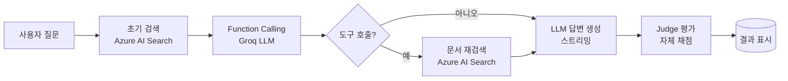

# Azure AI Search PoC

**Azure AI Search 기반 RAG(Retrieval-Augmented Generation) 데모** — 실시간 검색 → Function Calling → 스트리밍 답변 → LLM-as-Judge 자체 평가까지, 하나의 요청 안에서 벌어지는 전체 파이프라인을 화면에 그대로 노출합니다.

> 사내 AI 개발 플랫폼에서 요구되는 **RAG / Function Calling / Tool Use 표준 구현체**를 축소판으로 재현한 PoC입니다.

## 왜 만들었나

운영 환경을 가정한 RAG 서비스는 "검색 → 모델 호출 → 답변"이라는 단순 흐름을 넘어, (1) 모델이 검색 쿼리를 재구성해야 하는지 스스로 판단하고, (2) 필요한 경우 재검색을 수행하며, (3) 생성된 답변의 품질을 다시 모델로 검증하는 흐름까지 포함합니다. 이 PoC는 그 전체 흐름을 **인위적인 지연 없이, 매 단계가 실제 Azure Search / LLM 호출로 구성**되도록 만들었습니다 — 즉 화면에 보이는 모든 단계는 실제로 일어나는 작업입니다.

## 아키텍처 / Workflow



화면의 Workflow 패널은 백엔드가 SSE(Server-Sent Events)로 보내는 `step` / `branch` / `token` / `judge` / `done` 이벤트를 그대로 구독해서, 실제 파이프라인 진행 상태를 블록 단위로 하이라이트합니다. LLM이 "도구를 호출할지 말지" 직접 판단한 결과(예/아니오)에 따라 재검색 여부가 실시간으로 갈립니다.

## 주요 기능

| 영역 | 설명 |
|---|---|
| **RAG 검색** | Azure AI Search (Free tier, BM25 키워드 검색)로 Azure AI 공식 문서 345개 청크 중 관련 문서를 조회 |
| **Function Calling** | `tool_choice="required"`로 LLM이 검색 쿼리를 직접 재구성 — 원본 질문과 다른 쿼리를 생성할 수도, 재검색을 건너뛸 수도 있음 |
| **스트리밍 답변** | SSE 기반 토큰 스트리밍 + Markdown 실시간 렌더링(표, 코드블록, 목록 포함) |
| **LLM-as-Judge** | 생성된 답변을 같은 모델이 관련성·완결성·근거 부합도 3축으로 자체 채점하는 품질 지표 |
| **실시간 워크플로 시각화** | 8단계 블록 다이어그램이 SSE 이벤트에 맞춰 active → done으로 전환, 분기(예/아니오) 경로도 시각적으로 표시 |
| **출처 중복 제거** | 같은 문서의 여러 청크가 검색돼도 URL 기준으로 중복 없이 출처 목록 표시 |

## 기술 스택

- **백엔드**: FastAPI, `asyncio.to_thread`로 동기 SDK 호출을 논블로킹 처리
- **검색**: Azure AI Search (`azure-search-documents` SDK)
- **LLM**: Groq API, `openai/gpt-oss-20b` (OpenAI 호환 SDK 사용)
- **프론트엔드**: 바닐라 JS + SSE, `markdown-it`으로 답변 렌더링
- **배포**: Render.com (Blueprint, `render.yaml` 포함)

## 로컬 실행

Python 3.11 이상 환경에서:

```bash
python3 -m venv .venv
source .venv/bin/activate
pip install -r requirements.txt
uvicorn main:app --host 127.0.0.1 --port 8000 --reload
```

`.env`에 아래 값을 설정합니다 (키는 Git에 올리지 마세요 — `.gitignore`에 이미 포함되어 있습니다):

| 변수 | 설명 |
|---|---|
| `AZURE_SEARCH_ENDPOINT` | `https://<서비스이름>.search.windows.net` |
| `AZURE_SEARCH_API_KEY` | Azure AI Search 관리자 키 |
| `AZURE_SEARCH_INDEX_NAME` | 인덱스 이름 (기본값: `azure-ai-foundry-docs`) |
| `GITHUB_TOKEN` | Groq API 키 (`gsk_...`로 시작 — 변수명은 과거 GitHub Models 사용 당시의 흔적) |
| `GITHUB_MODEL` | 사용할 모델 (기본값: `openai/gpt-oss-20b`) |
| `GITHUB_ENDPOINT` | `https://api.groq.com/openai/v1` |

화면은 `http://127.0.0.1:8000`, 상태 확인은 `/health`입니다. 정상 동작을 위해 `static/index.html`을 직접 열지 말고 반드시 백엔드 서버를 통해 접속하세요.

데모 결과는 전체 표시 시간이 최소 15초를 유지하도록 완료 후 남은 시간만큼 대기하며, 화면에 "데모 시간 조정"으로 표시됩니다. 발표·시연 상황에서 각 단계를 충분히 확인할 수 있도록 하기 위한 장치이며, 모든 단계는 실제 호출 결과를 그대로 반영합니다.

## API

| Method | Path | 설명 |
|---|---|---|
| `POST` | `/demo` | `{"question": "..."}`를 받아 SSE 스트림으로 파이프라인 진행 상태 + 토큰 + 평가 결과를 전송 |
| `GET` | `/health` | 헬스체크 (`{"status": "ok"}`) |

## Render 배포

저장소 루트에 [render.yaml](render.yaml)이 포함되어 있습니다.

1. [render.com](https://render.com) → **New → Blueprint**
2. 이 GitHub 저장소 연결 → `render.yaml` 자동 인식
3. 환경변수 입력 화면에서 `AZURE_SEARCH_ENDPOINT`, `AZURE_SEARCH_API_KEY`, `GITHUB_TOKEN`(Groq 키) 입력
4. 배포 완료 후 `/health`로 정상 기동 확인

`sync: false`로 지정된 값은 이후 Blueprint 동기화에 반영되지 않으므로, 키를 변경할 때는 서비스의 Environment 탭에서 직접 수정해야 합니다.

## 운영 참고사항

- Render Free / Azure AI Search Free / Groq Free tier로 구성된 PoC·데모 전용 환경입니다.
- Render 무료 웹 서비스는 일정 시간 유휴 상태 후 슬립 모드로 전환되므로, 시연 전 미리 한 번 접속해 두는 것을 권장합니다.
- LLM-as-Judge 점수는 모델이 스스로 산출하는 품질 지표로, 외부 검증 체계와 별도로 운영됩니다.
- 검색 인덱스는 Azure AI 공식 문서 345개 청크로 구성되어 있으며, 해당 범위의 질문에 최적화되어 있습니다.
